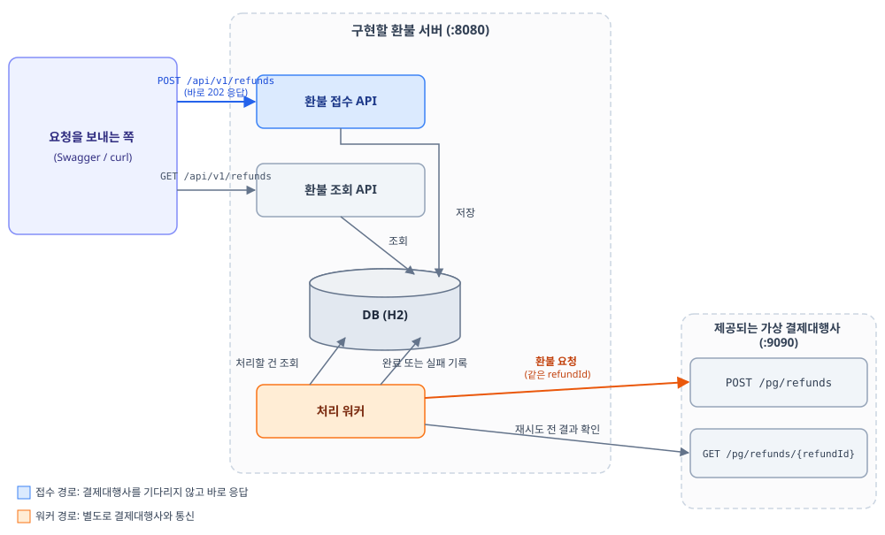
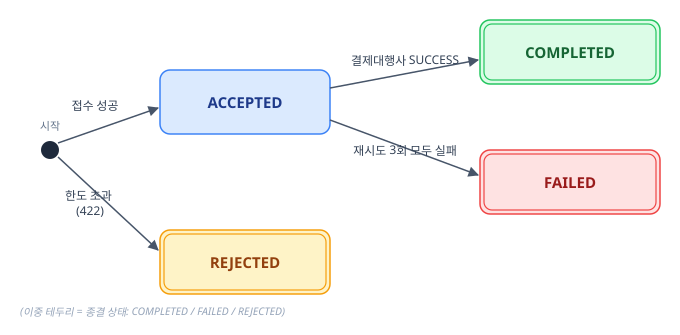
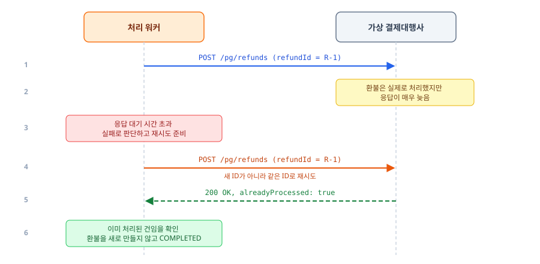

# 환불 요청 중계 서버

> 백엔드 사전 과제 (문서 버전 v1.4, 2026-10-20)

> [!IMPORTANT]
> **과제 시작 전 확인 사항**
> - 요청 및 응답 형식, 상태 코드, 에러 코드, 재시도 횟수와 시간 제한 등 이 문서에 적힌 요구사항은 반드시 지켜야 합니다.
>   - 다만, 이를 구현하기 위한 내부 설계와 구체적인 구현 방식은 자유롭게 결정할 수 있습니다.
> - 정해진 정답이 있는 과제가 아니므로, 요구사항을 충족하는 범위에서 적절한 설계와 구현 방법을 선택해 주세요.

> [!TIP]
> - 처음이라면 3페이지 요약 자료 [`docs/requirements-overview.pdf`](docs/requirements-overview.pdf)로 전체 흐름을 먼저 본 뒤, 이 문서를 처음부터 끝까지 읽어 주세요.
> - 세부 요구사항은 이 문서를 기준으로 합니다.

## 과제 개요

- 환불 요청을 받아 외부 결제대행사에 전달하는 환불 서버 1개를 구현합니다. 이하 이 서버를 **환불 서버**라고 부릅니다.
- 결제대행사는 응답이 느리거나 실패할 수 있습니다. 환불 서버는 응답이 늦어 실패로 판단했지만, 결제대행사는 이미 환불을 처리한 경우도 있습니다.
- 평가에서는 서버를 어떤 구조로 만들었는지, 그 구조를 선택한 이유가 무엇인지를 중점적으로 봅니다.
- 기술 스택은 Java 17, Spring Boot 4.1.1, Gradle, JPA, H2입니다. 제한 시간은 없습니다.

## 목차

- [과제 저장소 구성](#과제-저장소-구성)
- [1. 과제 소개](#1-과제-소개)
- [2. 전체 구조](#2-전체-구조)
- [3. 시작하기](#3-시작하기)
- [4. 용어 설명](#4-용어-설명)
- [5. 구현할 API 명세](#5-구현할-api-명세)
- [6. 가상 결제대행사 API 명세](#6-가상-결제대행사-api-명세)
- [7. 시나리오 체크리스트](#7-시나리오-체크리스트)
- [8. 설계 문서](#8-설계-문서)
- [9. 제출 방법](#9-제출-방법)
- [10. 평가 안내](#10-평가-안내)
- [11. 힌트](#11-힌트)

---

## 과제 저장소 구성

| 파일 및 폴더 | 용도 |
|---|---|
| `README.md` | 이 문서. 과제 설명, API 명세, 시나리오, 힌트 |
| [`docs/requirements-overview.pdf`](docs/requirements-overview.pdf) | 3페이지 분량의 과제 요약 자료 |
| `starter-project/` | 과제를 시작할 프로젝트. 빌드 설정만 있고 환불 기능 코드(엔티티, API, 워커 등)는 없습니다. **이 폴더가 제출 저장소의 최상위가 됩니다.** |
| `compose.yaml` | 가상 결제대행사 실행 설정 |
| `docs-template/design.md` | 설계 문서 템플릿. `starter-project/docs/design.md`로 복사해서 작성해 주세요. |
| `requests.http` | 시나리오 확인용 요청 예시 (IntelliJ HTTP Client 형식) |

---

## 1. 과제 소개

쇼핑몰에서 고객이 환불을 요청하면 쇼핑몰 서버가 환불 서버에 환불 요청을 보내고, 환불 서버는 이 요청을 결제대행사에 전달합니다. 그런데 결제대행사에서는 아래와 같은 일이 생길 수 있습니다.

- 환불 요청이 실패합니다.
- 내부 오류(HTTP 500번대 상태 코드, 이하 5xx)를 응답합니다.
- 응답이 몇 초 이상 걸립니다.
- 응답은 늦었지만 실제로는 환불을 이미 처리했습니다.

이런 상황에서도 **모든 환불 요청이 누락 없이 한 번만 처리되도록** 환불 서버를 설계하고 구현하는 것이 과제입니다. 결정한 내용과 이유는 설계 문서에 작성해 주세요(8장).

## 2. 전체 구조

- 환불 서버는 환불 접수 API, 환불 조회 API, DB, 처리 워커로 구성합니다.
- 가상 결제대행사(Docker 이미지), 이 문서, 설계 문서 템플릿, 요청 예시 파일을 제공합니다.

아래 그림은 요청이 환불 서버를 거쳐 가상 결제대행사까지 전달되는 흐름입니다.

- 환불 접수 API(파란색)는 결제대행사의 응답을 기다리지 않고 바로 응답합니다.
- 결제대행사 호출은 처리 워커(주황색)가 별도로 담당합니다.



## 3. 시작하기

JDK 17과 Docker가 필요합니다.

1. 가상 결제대행사를 실행합니다. 이미지는 자동으로 내려받습니다.
   ```bash
   docker compose up
   ```
2. 브라우저에서 `http://localhost:9090/swagger-ui.html`을 엽니다. 결제대행사 API를 보고 직접 호출해 볼 수 있는 문서 화면(Swagger)입니다.
3. 환불 서버를 `8080` 포트로 실행합니다.
   ```bash
   cd starter-project
   ./gradlew bootRun
   ```

## 4. 용어 설명

| 용어 | 뜻 |
|---|---|
| **결제대행사 (PG)** | 실제 환불을 수행하는 외부 업체입니다. 이 과제에서는 가상 결제대행사를 씁니다. 코드와 에러 코드에서는 `PG`로 표기합니다. |
| **환불 ID (`refundId`)** | 환불 요청 하나를 구분하는 고유 번호입니다. |
| **멱등성** | 같은 요청을 여러 번 보내도 한 번 보낸 것과 결과가 같은 성질입니다. 같은 송장번호로 택배를 두 번 접수해도 한 번만 배송되는 것과 같습니다. |
| **재시도** | 요청이 실패했을 때 같은 요청을 다시 보내는 것입니다. |
| **타임아웃 (응답 대기 시간 초과)** | 응답을 기다리는 최대 시간을 정해 두고, 그 시간이 지나면 실패로 판단하는 것입니다. |
| **접수 단계** | 들어온 요청을 검증하고 저장하는 단계입니다. 결제대행사를 기다리지 않고 바로 응답해야 합니다. |
| **처리 단계** | 저장된 요청을 결제대행사에 전달하는 단계입니다. |
| **처리 워커** | 처리 단계를 담당하는 백그라운드 작업입니다. |

---

## 5. 구현할 API 명세

### 5-1. 에러 응답 형식 (모든 API 공통)

```json
{ "code": "REFUND_LIMIT_EXCEEDED", "message": "환불 한도를 초과했습니다.", "refundId": "R-1001" }
```

| 에러 코드 | 상태 코드 | 상황 |
|---|---|---|
| `INVALID_REQUEST` | 400 | 입력 오류 |
| `REFUND_ID_CONFLICT` | 409 | 같은 환불 ID, 다른 내용 |
| `REFUND_LIMIT_EXCEEDED` | 422 | 환불 한도 초과 |
| `REFUND_NOT_FOUND` | 404 | 없는 환불 ID 조회 |

### 5-2. 환불 접수

`POST /api/v1/refunds`

```json
{
  "refundId": "R-1001",
  "orderId": "ORD-2001",
  "paidAmount": 10000,
  "refundAmount": 3000,
  "reason": "단순 변심"
}
```

| 필드 | 규칙 |
|---|---|
| `refundId` | 환불 ID. 필수, 1~50자 |
| `orderId` | 주문 번호. 필수 |
| `paidAmount` | 최초 결제 금액. 필수, 1 이상. 환불 한도는 이번 요청에 담긴 이 값으로 계산합니다(주문 정보를 따로 조회하지 않음). |
| `refundAmount` | 환불 금액. 필수, 1 이상 |
| `reason` | 환불 사유. 선택 |

**같은 환불 ID로 다시 들어온 요청**

- `orderId`, `paidAmount`, `refundAmount`가 모두 같으면 같은 내용으로 봅니다. `reason`은 비교하지 않습니다.
- 같은 내용이면 중복 요청입니다. 새로 저장하지 않고, 기존 건의 현재 상태를 돌려줍니다(200).
- 내용이 다르면 충돌입니다. 기존 건은 바꾸지 않고 409를 응답합니다.

**응답**

| 상황 | 상태 코드 | 본문 |
|---|---|---|
| 새로 접수됨 | **202** | `{"refundId":"R-1001","status":"ACCEPTED","duplicate":false}` |
| 같은 환불 ID, 같은 내용 | **200** | 기존 건의 현재 상태. 예: `{"refundId":"R-1001","status":"COMPLETED","duplicate":true,"failureReason":null}` (실패 사유가 없으면 `null`) |
| 환불 한도 초과 | **422** | 에러 본문. 거절 기록은 `REJECTED` 상태로 저장 |
| 같은 환불 ID, 다른 내용 | **409** | 에러 본문. 저장하지 않음 |
| 입력 오류 | **400** | 에러 본문. 저장하지 않음 |

> [!IMPORTANT]
> **환불 한도 규칙**
> - 같은 `orderId`에서 다음 조건을 만족해야 접수할 수 있습니다.
>   - `ACCEPTED`와 `COMPLETED` 상태인 환불 금액의 합 + 이번 `refundAmount` ≤ `paidAmount`
>   - 내부에서 상태를 더 나눴다면(5-4), API에 `ACCEPTED`로 보이는 상태는 모두 합계에 포함합니다.
> - `REJECTED`와 `FAILED` 상태는 환불되지 않은 건이므로 합계에서 제외합니다.

**거절된 요청을 같은 환불 ID로 다시 보낸 경우**

- 같은 내용이면 한도를 다시 계산하지 않고 기존 결과(200, `status: REJECTED`, `duplicate: true`)를 돌려줍니다.
- 내용이 다르면 409입니다.

### 5-3. 환불 조회

- 단건 조회: `GET /api/v1/refunds/{refundId}`
  - 응답 본문은 아래 목록의 항목 하나와 같은 형식입니다.
  - 해당 환불 ID가 없으면 404(`REFUND_NOT_FOUND`)를 응답합니다.
- 목록 조회: `GET /api/v1/refunds?orderId=ORD-2001&page=0&size=20`
  - `orderId`는 필수입니다. 없으면 400(`INVALID_REQUEST`)을 응답합니다.
  - `page`는 0부터 시작합니다(기본값 0). `size`는 1~100입니다(기본값 20).
  - 접수 시각(`requestedAt`) 기준 최신순으로 정렬합니다.

```json
{
  "items": [
    {
      "refundId": "R-1001", "orderId": "ORD-2001", "refundAmount": 3000,
      "status": "COMPLETED", "failureReason": null, "attemptCount": 1,
      "requestedAt": "2026-09-21T10:00:00", "completedAt": "2026-09-21T10:00:03"
    }
  ],
  "page": 0, "size": 20, "totalElements": 1, "totalPages": 1
}
```

### 5-4. 상태와 실패 사유

| 상태 | 의미 |
|---|---|
| `ACCEPTED` | 접수됨. 처리 대기 중이거나 처리 또는 재시도 중 |
| `COMPLETED` | 결제대행사가 환불을 성공 처리함 |
| `FAILED` | 재시도를 모두 마친 뒤 최종 실패함 |
| `REJECTED` | 접수 단계에서 한도 초과로 거절됨 |

- 내부적으로는 더 세분화한 상태(예: 재시도 대기)를 사용해도 됩니다. 다만 API 응답에서는 위 4개 상태만 보여야 합니다.
- 입력 오류(400)와 충돌(409)은 저장하지 않으므로 상태가 없습니다.



| `failureReason` | 상황 |
|---|---|
| `REFUND_LIMIT_EXCEEDED` | 한도 초과 (`REJECTED`) |
| `PG_DECLINED` | 결제대행사가 `result: FAIL`로 응답함 (`FAILED`) |
| `PG_ERROR` | 결제대행사가 5xx로 응답함 (`FAILED`) |
| `PG_TIMEOUT` | 응답 대기 시간을 초과함 (`FAILED`) |

- 최종 실패한 건의 실패 사유에는 마지막 시도가 실패한 원인을 기록합니다.

### 5-5. 재시도 규칙

- 최초 시도가 실패하면 **최대 3회 재시도**합니다. 최초 시도를 포함해 최대 4번 시도합니다.
- 결제대행사의 `FAIL` 응답, 5xx 응답, 타임아웃은 모두 재시도합니다.
- **재시도할 때도 결제대행사에 같은 `refundId`를 보내야 합니다.**
- 재시도 간격과 응답 대기 시간은 자유롭게 정할 수 있습니다.
  - 다만 **결제대행사에 처음 요청을 보낸 시점부터 종결 상태(`COMPLETED` 또는 `FAILED`)가 될 때까지 60초를 넘지 않도록** 설계해 주세요. 같은 주문의 앞 건을 기다리는 시간은 포함하지 않습니다.
  - 결제대행사 응답이 매우 느릴 수 있으므로, 응답 대기 시간은 5초 안팎을 권장합니다.

### 5-6. 처리 순서

- 같은 주문에 환불이 여러 건 있으면 **접수 순서대로 한 건씩** 처리합니다.
  - 앞 건이 종결되기 전에는 다음 건을 결제대행사에 보내지 않습니다.
- 서로 다른 주문의 환불은 동시에 처리해도 됩니다.

---

## 6. 가상 결제대행사 API 명세

- 주소: `http://localhost:9090`
- 자세한 명세는 Swagger(`http://localhost:9090/swagger-ui.html`)에서 확인할 수 있습니다.

### 환불 요청

`POST /pg/refunds`

```json
{ "refundId": "R-1001", "orderId": "ORD-2001", "amount": 3000 }
```

응답 (HTTP 200)

```json
{ "refundId": "R-1001", "result": "SUCCESS", "alreadyProcessed": false, "processedAt": "2026-09-21T10:00:03" }
```

| `result` | 의미 |
|---|---|
| `SUCCESS` | 환불 성공 |
| `FAIL` | 환불 실패 |

- 5xx 응답은 결제대행사의 내부 오류입니다.
- 응답이 몇 초 이상 걸릴 수 있습니다.

### 환불 결과 조회

`GET /pg/refunds/{refundId}`

```json
{ "refundId": "R-1001", "status": "PROCESSED", "amount": 3000, "processedAt": "2026-09-21T10:00:03" }
```

- `status` 값은 `PROCESSED`(처리됨) 또는 `NOT_FOUND`(처리 기록 없음)입니다.
- 이 API는 쓰지 않아도 됩니다. 재시도하기 전에 이미 처리됐는지 확인하는 용도로 쓸 수 있습니다.

### 같은 환불 ID에 대한 결제대행사의 동작 (중요)

| 상황 | 결제대행사의 동작 |
|---|---|
| **성공한** 환불 ID로 다시 요청 | 환불을 다시 하지 않고 이전 성공 결과를 돌려줌 (`result: SUCCESS`, `alreadyProcessed: true`) |
| **응답을 아직 받지 못한** 환불 ID로 다시 요청 | 결제대행사는 요청을 받는 순간 처리 여부를 정하고, 응답만 늦게 보냅니다. 앞 요청이 이미 처리됐다면 위 행과 같이 이전 성공 결과를 돌려주고, 처리되지 않았다면 아래 행과 같이 새로 처리를 시도합니다. 같은 환불이 두 번 처리되지는 않습니다. |
| **실패한** 환불 ID로 다시 요청 | 환불되지 않은 건이므로 새로 처리를 시도함 |
| **다른** 환불 ID로 요청 | 같은 주문이라도 완전히 다른 요청으로 처리함 |

이 동작은 다음 상황에서 중요합니다.

- 결제대행사는 실제로 환불을 처리했지만, 응답이 너무 늦게 도착했습니다.
- 환불 서버는 응답 대기 시간이 지나 이 요청을 실패(타임아웃)로 판단합니다.
- 이때 같은 `refundId`로 재시도하면, 결제대행사는 이미 처리한 건이라고 응답하고 환불을 다시 하지 않습니다.

아래 그림(시퀀스 다이어그램)은 이 흐름을 시간 순서대로 보여 줍니다.



> [!TIP]
> - 위 표의 동작을 활용해 환불이 두 번 처리되지 않게 할 방법을 고민해 보세요.
> - [11장 힌트 3](#11-힌트)에서 다시 다룹니다.

---

## 7. 시나리오 체크리스트

환불 서버는 아래 모든 시나리오에서 기대 결과대로 동작해야 합니다. 구현을 마친 뒤 점검용 체크리스트로도 사용해 주세요.

### 접수 단계

| # | 시나리오 | 기대 결과 |
|---|---|---|
| S1 | 정상 환불 요청 | 바로 **202 응답, `status: ACCEPTED`**, 요청 저장. 결제대행사의 응답을 기다리지 않음 |
| S2 | 같은 환불 ID, **같은 내용**으로 다시 요청 | **200**, 기존 건의 현재 상태 반환 (`duplicate: true`). 새로 저장하지 않음 |
| S3 | 같은 환불 ID, **다른 내용**으로 요청 (예: 금액이 다름) | **409 `REFUND_ID_CONFLICT`**. 기존 건은 변경하지 않음 |
| S4 | **같은 환불 ID** 요청이 **동시에 여러 건** 들어옴 | **정확히 1건만 저장**. 나머지는 S2와 같이 기존 결과 반환 |
| S5 | 이미 접수된 환불 금액과 이번 금액의 합이 결제 금액을 초과함 | **422 `REFUND_LIMIT_EXCEEDED`**, `REJECTED` 상태로 저장, 실패 사유 기록 |
| S6 | **같은 주문**에 **서로 다른 환불 ID** 요청이 **동시에** 들어오고, 합계가 결제 금액을 초과함 | 한도 안에서만 접수하고 나머지는 거절. 접수된 금액의 합계가 한도를 넘지 않음 |
| S7 | 금액이 0 이하이거나 필수값이 누락됨 | **400 `INVALID_REQUEST`** |

S6 예시: 결제 금액이 10,000원인 주문에 4,000원 환불 요청 3건이 서로 다른 환불 ID로 동시에 들어오면 2건은 접수(`ACCEPTED`), 1건은 거절(`REJECTED`)되어야 합니다.

### 처리 단계

| # | 시나리오 | 기대 결과 |
|---|---|---|
| S8 | 결제대행사가 `SUCCESS`로 응답 | 상태 **`COMPLETED`**, 완료 시각(`completedAt`) 기록 |
| S9 | 결제대행사가 `FAIL` 또는 5xx로 응답 | **최대 3회 재시도**. 계속 실패하면 **`FAILED`** 상태와 실패 사유 기록. 중간에 성공하면 `COMPLETED` |
| S10 | 결제대행사 응답이 너무 느림 (응답 대기 시간 초과) | 실패로 보고 재시도. 재시도를 모두 마치면 `FAILED`와 `PG_TIMEOUT` 기록 |
| S11 | **같은 주문**에 환불이 여러 건 있음 | 접수 순서대로 **한 건씩** 결제대행사에 전달. 다른 주문은 동시에 처리 가능 |
| S12 | 결제대행사가 **환불을 처리했지만 응답을 너무 늦게** 보냄 (환불 서버 입장에서는 시간 초과로 판단됨) | 재시도해도 **환불은 정확히 1번만** 처리됨. 최종 상태는 `COMPLETED` |

- S12는 이 과제에서 가장 놓치기 쉬운 시나리오입니다. 자세한 흐름은 [6장](#6-가상-결제대행사-api-명세)의 시퀀스 다이어그램을 참고해 주세요.

### 조회

| # | 시나리오 | 기대 결과 |
|---|---|---|
| S13 | 주문별 환불 목록 조회 | 최신순 정렬, 페이지 나누기 (`page`, `size`, `totalElements`, `totalPages`), 상태와 실패 사유 포함 |

---

## 8. 설계 문서

- `starter-project/docs/design.md`에 아래 **5개 제목을 그대로** 사용해 작성해 주세요. 맨 위 `# 설계 문서`는 문서 제목이고, 5개 제목은 그 아래 `##` 제목입니다.
- 각 항목에는 무엇을 선택했는지, 왜 그렇게 결정했는지를 적어 주세요. 괄호 안 안내문은 지우고 작성합니다.
  - 다른 선택지와 비교한 내용이나, 선택한 방식의 한계를 함께 적으면 더 좋습니다.

```markdown
# 설계 문서

## 1. 상태 정의
(API에 보이는 4개 상태 외에 내부에서 어떤 상태를 썼고, 각 상태가 언제 바뀌는지)

## 2. 재시도 방식
(응답 대기 시간, 재시도 간격, 종료 조건, 최종 실패 처리, 그렇게 정한 이유)

## 3. 중복 방지 방법
(같은 환불 ID 요청, 동시 요청, 같은 주문의 요청이 동시에 들어와 한도 합계를 함께 계산할 때의 충돌을 막은 방법과 이유)

## 4. 시간 초과 처리
(응답 대기 시간 초과 후 이중 환불을 막는 방법과 이유)

## 5. 순서 처리 방식
(같은 주문의 순서를 보장하는 방법, 그 방법 때문에 동시에 처리할 수 있는 건수가 얼마나 줄어드는지, 선택한 이유)
```

## 9. 제출 방법

- `starter-project/` 폴더 안의 파일이 제출 저장소의 최상위에 오도록 올려 주세요. 이 장에서 말하는 루트는 이 폴더입니다.
- 루트에 Gradle 프로젝트, 제출 README(`README.md`), 설계 문서(`docs/design.md`)를 둡니다.
  - 제출 README는 `starter-project/README.md`의 내용을 지우고, 실행 방법과 직접 확인한 시나리오로 바꿔 써 주세요.
- 루트에서 `./gradlew bootRun`으로 실행되어야 하며, 포트는 8080입니다.
- 결제대행사 주소는 환경변수 `PG_BASE_URL`로 바꿀 수 있어야 합니다. 기본값은 `http://localhost:9090`입니다.
- DB는 H2를 사용하며, 별도 설치 없이 실행할 수 있어야 합니다.

**제출 전 확인 사항**

- [ ] `docker compose up`으로 가상 결제대행사가 실행된다
- [ ] `./gradlew bootRun`으로 환불 서버가 8080 포트에서 실행된다
- [ ] `requests.http`의 요청을 모두 실행해 확인했다 (동시 요청과 처리 단계 시나리오는 따로 확인)
- [ ] `docs/design.md`를 5개 제목 그대로 작성했다
- [ ] 테스트를 작성했다면 `./gradlew test`가 통과한다

## 10. 평가 안내

| 영역 | 배점 | 내용 |
|---|---|---|
| A. 기능 정확성 | 35 | 시나리오 S1~S13 통과 여부 |
| B. 설계 품질 | 35 | DB 설계, 접수와 처리의 분리, 재시도, 중복 방지, 시간 초과 처리, 순서 처리 |
| C. 설계 문서 | 15 | 필수 5개 항목 작성, 선택의 근거, 선택한 방식의 한계를 스스로 적었는지 |
| D. 코드 품질 | 10 | 구조, 에러 응답, 가독성, 테스트 |
| **합계** | **100** | |

> [!WARNING]
> 다음 경우에는 크게 감점됩니다.
> - 같은 환불이 두 번 처리됨 (이중 환불)
> - 재시도할 때 `refundId`가 바뀜
> - 접수 API가 결제대행사의 응답을 기다림 (접수 응답이 느려짐)
> - 9장의 방법(`./gradlew bootRun`, 8080 포트)으로 서버가 실행되지 않음

## 11. 힌트

구현하다 막혔을 때 하나씩 열어 보세요.

<details>
<summary><b>힌트 1: 전체 구조</b></summary>
<br>

- 접수 API는 요청을 검증하고 DB에 저장한 뒤 바로 응답합니다.
- 결제대행사 호출은 **주기적으로 실행되는 처리 워커**가 DB에서 처리할 건을 꺼내 수행합니다.

</details>

<details>
<summary><b>힌트 2: 중복 요청과 동시 요청</b></summary>
<br>

- 조회한 뒤 없으면 저장하는 방식은, 같은 요청이 동시에 들어오면 두 요청 모두 기존 건이 없다고 판단할 수 있습니다.
- 이런 경우를 마지막으로 막는 수단은 **DB의 유일 제약**(UNIQUE 제약: 같은 값이 두 번 저장되지 못하게 막는 규칙)입니다.
- 한도 합계를 확인할 때는 조회와 저장이 **하나의 단위로 함께** 처리되어야 합니다.

</details>

<details>
<summary><b>힌트 3: 이중 환불</b></summary>
<br>

- 응답이 늦어 실패로 판단했지만, 결제대행사는 이미 환불을 처리했을 수 있습니다.
- 다시 요청할 때 **같은 환불 ID**를 사용하면 결제대행사가 어떻게 응답하는지 [6장](#6-가상-결제대행사-api-명세)의 표와 시퀀스 다이어그램을 다시 확인해 보세요.

</details>

<details>
<summary><b>힌트 4: 순서 처리</b></summary>
<br>

- 같은 주문은 한 건씩, 다른 주문은 동시에 처리하려면 처리 워커가 **어떤 건을 골라야 할지** 생각해 보세요.

</details>
